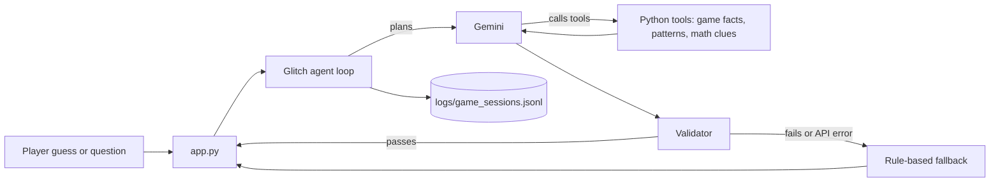

# 🎮 Glitch: An Adaptive AI Opponent for a Number-Guessing Game

## Original project
This builds on **Game Glitch Investigator: The Impossible Guesser** (Modules 1–3).
That project was a Streamlit number-guessing game shipped with deliberate bugs.
The goal was to find them, fix them, and prove the fixes with tests. The bugs
included reversed "Too High / Too Low" hints, wrong-guess scoring that sometimes
gave points, and a "Hard" mode that was easier than "Normal".

## What this project does
I added **Glitch**, an AI opponent powered by Google Gemini. After every guess,
Glitch reads the game state, picks a style of response (neutral, direct, tense,
or redirecting), and writes a hint in character. It can also add a **math clue**
("the secret number is prime") and answer questions in an **Ask Glitch** box.

**Why it matters:** language models are good at tone but unreliable on facts. In
this project the AI never decides what is true. Python checks every fact, and
the AI only chooses how to say it. The game feels alive, but Glitch can't lie to
you or leak the answer.

## Architecture overview

The agent works in four steps: **Observe → Plan → Act → Evaluate**.
1. **Observe:** it reads verified facts (guess history, range left, attempts left).
2. **Plan:** Gemini picks a strategy.
3. **Act:** it writes the hint and picks a clue from a list Python already verified.
4. **Evaluate:** a validator checks for leaks, wrong direction, and invented math.

If a reply fails the check, or the API is down or rate-limited, a rule-based
fallback answers instead. Every step is logged.

## Setup
1. Clone the repo and open a terminal in its folder.
2. Install: `pip install -r requirements.txt`
3. Get a free Gemini API key and set it for your session (never save it in a file):
   - PowerShell: `$env:GEMINI_API_KEY="your-key"`
   - Mac/Linux: `export GEMINI_API_KEY="your-key"`
4. Run the app: `python -m streamlit run app.py`
5. Run the tests: `python -m pytest tests`

No key? The game still works and uses the rule-based hints.

## Sample interactions
Real outputs from the running app. Glitch's wording changes from run to run, but
every fact comes from Python.

### 1. Asking for a hint
**Input:** "give me a hint?"

**Glitch:**
> Let me check my notes... 🗒️
> 🔎 The secret number is an even number.

The in-character line is Glitch's. The 🔎 fact was chosen and verified by Python
from the real secret, and it's the gentlest unused clue.

### 2. Rule-based hint when the AI is unavailable
**Input:** a wrong guess that was too low

**Glitch:**
> Go HIGHER!
> 🔎 The secret number is NOT a prime number.
> *Rule-based hint · 😌 Calm*

The direction and the clue still came from Python, so the hint is still true.

### 3. The AI times out
**Input:** "is the number a perfect square?"

**What the app showed:**
> 🧠 Glitch is thinking...
> ⚠️ The AI could not respond (timed out). Answering with simple rules instead.
> 🔎 Python is checking the real number...

Python answered from the real secret, and the failure was logged.

### 4. Questions Glitch can't verify are declined
**Input:** "is it a sqaure number" (misspelled)

**Glitch:**
> Hmm, I can only check things like: is it prime, even or odd, a perfect square,
> divisible by 3-10, or what digit it ends in. Or just ask me for a hint!

If Glitch can't match a question, it says so instead of guessing.

### 5. Questions that would give the game away are refused
**Input:** "is it divisible by 3"

**Glitch:**
> Nice try, but that would give the game away. 🤫
> 🤫 I can't answer that one. It would give the game away.

Python won't answer if the answer would leave fewer than 3 possible numbers.
Note: a refusal can itself hint at the answer. See `model_card.md`.

## Design decisions and trade-offs
- **Python owns the truth.** The model never sees the secret. Hints can't leak or
  lie, but Glitch is less free-form.
- **Validator plus fallback.** Every AI reply is checked. This costs extra code,
  but the game never shows a wrong hint.
- **Clues keep at least 3 candidates.** They help without solving the game.
- **Free-tier limits and slow replies.** Gemini allows about 5 requests a minute.
  Each reply can take 6–14 seconds, and sometimes much longer or a timeout,
  because Glitch makes several calls per response. I accepted this and made the
  rule-based fallback the safety net. The "Glitch is thinking..." status box
  shows the player what's happening while they wait.

## Testing summary
Reliability is checked with automated tests, a simulation, and error logging.

| Check | Result |
|---|---|
| Automated tests (`python -m pytest tests`) | 53 passed, 0 failed |
| Simulated games (120 random secrets) | 0 incorrect hints |
| Math clues for every secret 1–100 | all true; always at least 3 numbers left |
| Validator rejects leaks, invented math, wrong direction | covered by tests |
| AI failure (network down, timeout, rate limit) | falls back; hint still true |

Every hint and error is logged to `logs/game_sessions.jsonl` with its source
(`llm` or `fallback`), so failures can be reviewed.

**What worked:** keeping facts in Python. Tests use a fake AI client, so they run
without a network.
**What didn't:** the validator once blocked a good hint (fixed, with a test);
old Streamlit servers kept serving stale code; rate limits and timeouts triggered
the fallback more than expected; the fallback doesn't catch typos like "sqaure".
**Takeaway:** test the guardrails harder than the happy path.

## Reflection
The AI part turned out to be the easy half. The hard half was deciding what the
AI is allowed to say. Giving the model small tools and keeping facts in Python
made it far more reliable than prompting alone. See `model_card.md` for my full
responsible-AI reflection.
